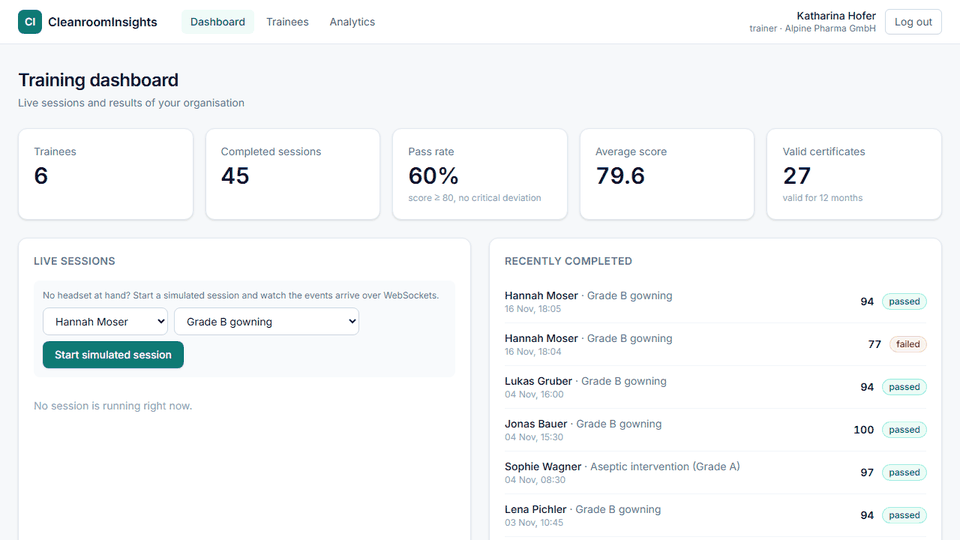
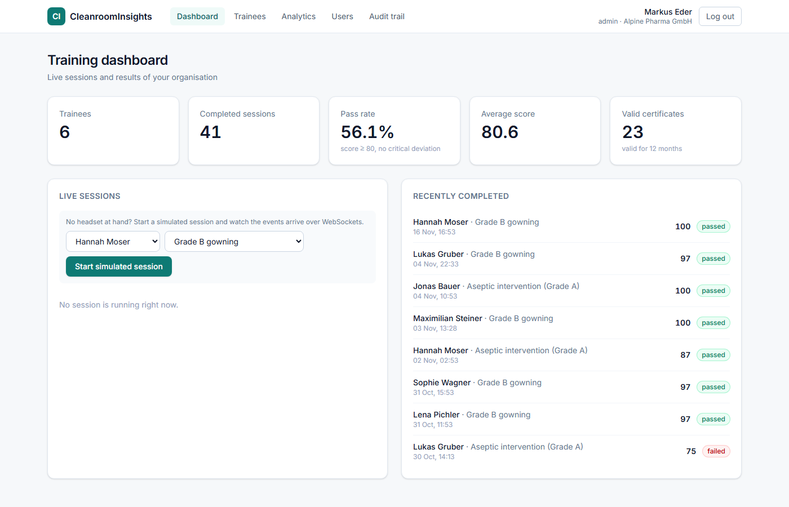
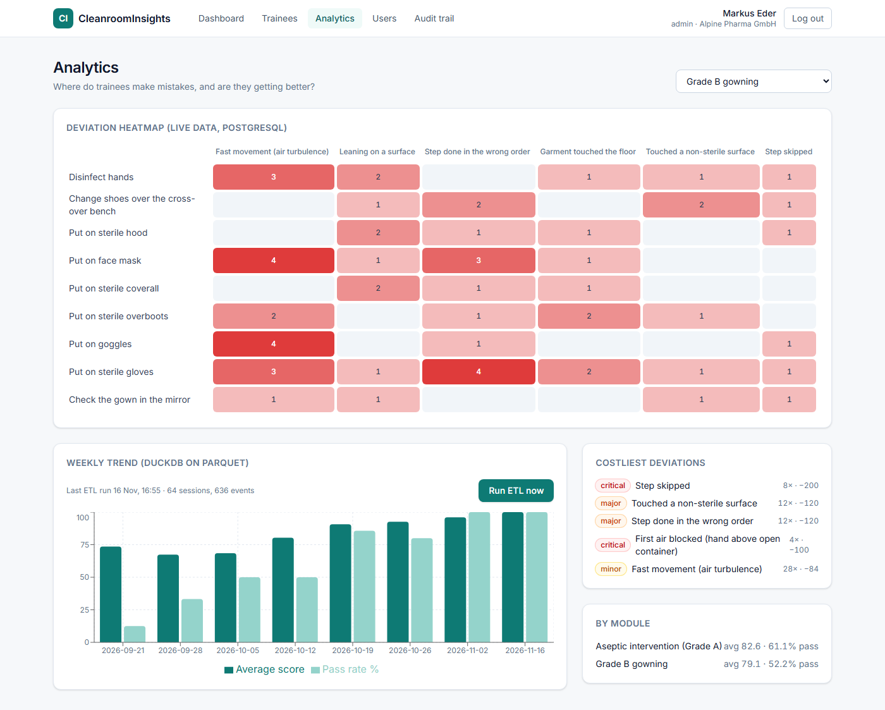
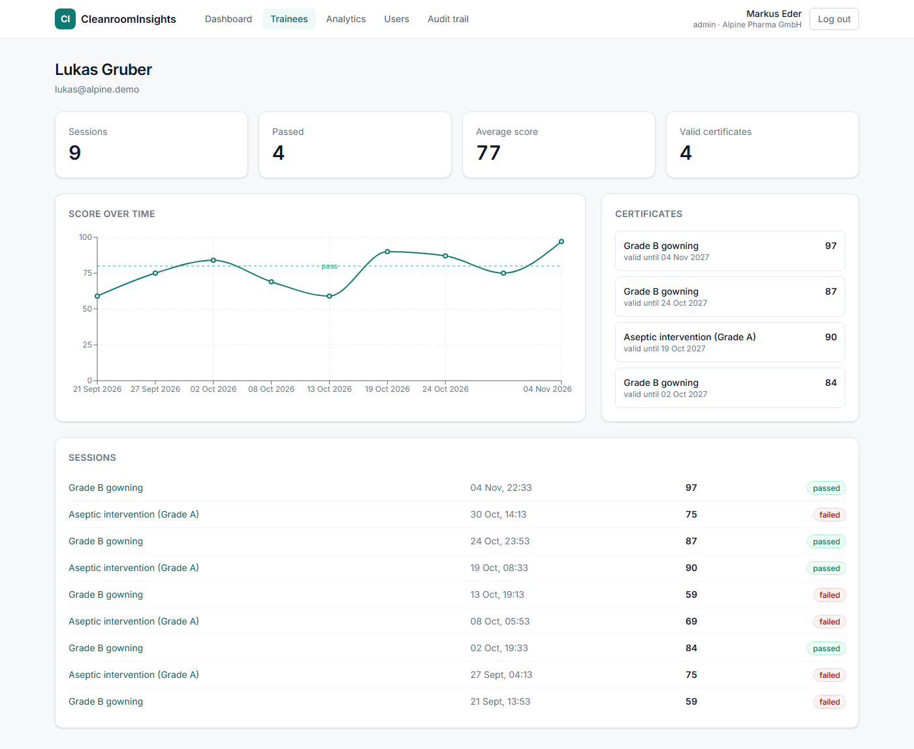
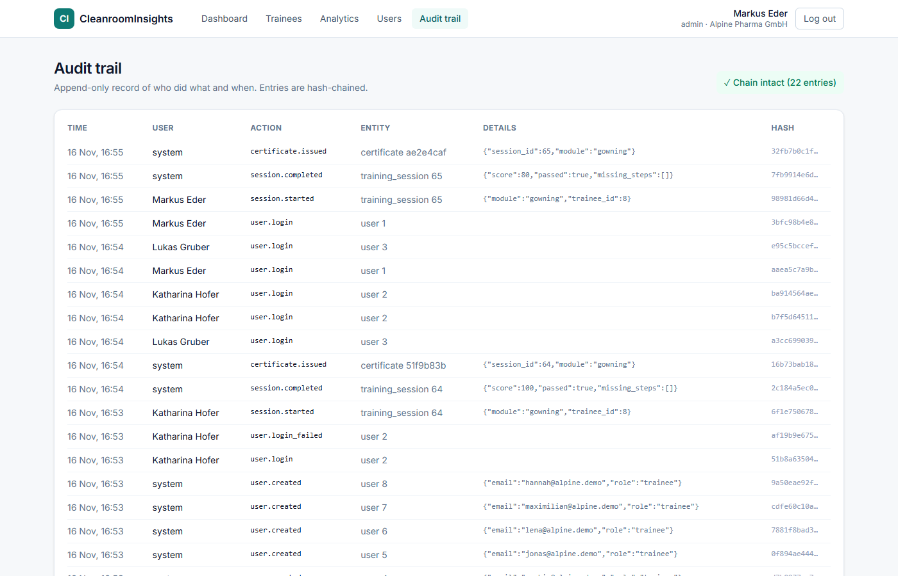
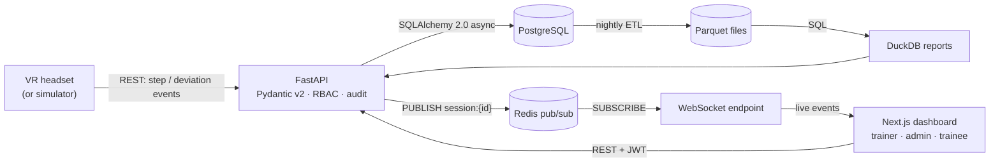
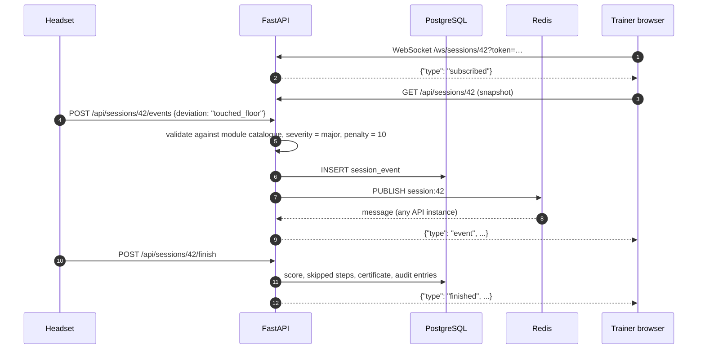
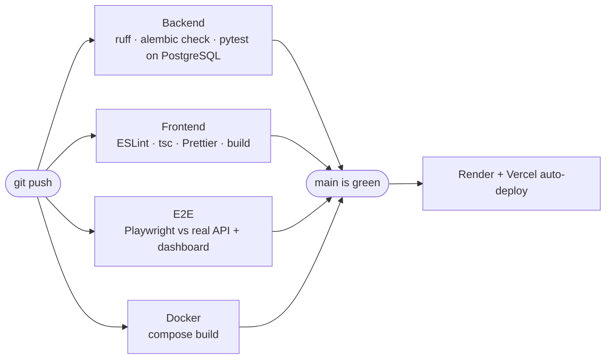

<div align="center">

# CleanroomInsights

**Real-time analytics for VR cleanroom training.**
Trainers watch gowning and aseptic-behaviour sessions live, see where people make mistakes,
and track every trainee's progress, with a GMP-style audit trail behind it.

[](https://github.com/vladimirmilivojevic-creator/cleanroom-insights/actions/workflows/ci.yml)


### [▶ Open the live demo](https://cleanroom-insights.vercel.app) · [API docs (OpenAPI)](https://cleanroom-insights-api.onrender.com/docs) · [How it works](#architecture)



<sub>A simulated headset plays a Grade B gowning session; the trainer sees every step and deviation as it happens.</sub>

</div>

---

## Try it in 30 seconds

Open the **[live demo](https://cleanroom-insights.vercel.app)** and use a one-click login (password `demo1234`):

| Account | Role | What you can do |
| --- | --- | --- |
| `trainer@alpine.demo` | **Trainer** | Start a simulated VR session and watch it live, trainee progress, deviation heatmap, DuckDB reports |
| `admin@alpine.demo` | **Admin** | Everything above + user management, audit trail with chain verification, run the ETL |
| `lukas@alpine.demo` | **Trainee** | Own progress, score history and printable certificates, nothing else |

A second tenant (`trainer@nordic.demo`) proves that organisations never see each other's data.

> [!NOTE]
> The API runs on a free plan. Outside working hours (CET) the first request can take up to a minute while the server wakes up. The login page shows the API status.

## Highlights

<table>
<tr>
<td width="50%" valign="top">

**Live sessions over WebSockets**
Headset events are stored in PostgreSQL and fanned out through **Redis pub/sub**, so every trainer watching sees each step and mistake as it happens. No missed events between the snapshot and the stream.

</td>
<td width="50%" valign="top">

**Server-side scoring & certificates**
The server owns the rules: severity and penalty come from one catalogue, never from the client. Pass = score ≥ 80 and no critical deviation. Certificates are valid 12 months and publicly verifiable.

</td>
</tr>
<tr>
<td valign="top">

**Multi-tenant security**
OAuth2 + JWT, bcrypt, three roles enforced as FastAPI dependencies. Every query is scoped to the caller's organisation; foreign objects return **404**, not 403.

</td>
<td valign="top">

**GMP-style audit trail**
Append-only and **SHA-256 hash-chained** per tenant. Edit or delete an old row directly in the database and `/api/audit/verify` shows exactly where the chain breaks. Concurrent writes are serialised with a row lock.

</td>
</tr>
<tr>
<td valign="top">

**Analytics off the operational DB**
Live KPIs and a step × deviation heatmap from SQL aggregations, plus a nightly **ETL to Parquet** where **DuckDB** computes weekly trends, pass rates and the costliest deviations.

</td>
<td valign="top">

**Production habits**
Alembic migrations checked in CI, 59 backend tests (97 % coverage) on a real PostgreSQL, Playwright end-to-end tests, Docker Compose, GitHub Actions, auto-deploy to Render and Vercel.

</td>
</tr>
</table>

## Screenshots

| Dashboard | Analytics: heatmap + DuckDB |
| --- | --- |
|  |  |
| **Trainee progress** | **Audit trail** |
|  |  |

## Architecture



### What happens when a trainee makes a mistake



## Tech stack

| Layer | Technology |
| --- | --- |
| API | Python 3.12, **FastAPI**, Pydantic v2, pydantic-settings, Uvicorn |
| Data | **PostgreSQL** (Neon), **SQLAlchemy 2.0 async** + asyncpg, **Alembic** |
| Real-time | **WebSockets**, **Redis** pub/sub (in-process fallback for local dev) |
| Analytics | **DuckDB** on **Parquet**, nightly ETL |
| Auth | OAuth2 password flow, JWT (PyJWT), bcrypt, role-based access control |
| Frontend | **Next.js 16** (App Router), React 19, **TypeScript**, Tailwind CSS 4, TanStack Query, Recharts |
| Quality | pytest + coverage, httpx, fakeredis, **Playwright**, ruff, ESLint, Prettier |
| Delivery | **Docker** / Docker Compose, **GitHub Actions**, Render (API + Key Value), Vercel (dashboard) |

## Domain

Two VR modules modelled on **EU GMP Annex 1**:

- **Grade B gowning**: 9 steps, from hand disinfection to the mirror check.
- **Aseptic intervention (Grade A)**: clearing a stopper jam on a filling line in a RABS, with environmental monitoring and documentation.

| Severity | Examples | Penalty |
| --- | --- | --- |
| minor | fast movement (air turbulence), leaning on a surface | −3 |
| major | garment touched the floor, non-sterile surface, overreaching, wrong order | −10 |
| critical | **first air blocked**, step skipped | −25 → always fails |

`score = 100 − penalties` · `passed = score ≥ 80 and no critical deviation` · certificate valid 365 days.

## API overview

Interactive docs: **[`/docs`](https://cleanroom-insights-api.onrender.com/docs)**

| Method | Path | Who |
| --- | --- | --- |
| `POST` | `/api/auth/login` · `GET /api/auth/me` | everyone |
| `GET` | `/api/modules` | authenticated |
| `POST` | `/api/sessions` · `/api/sessions/{id}/events` · `/api/sessions/{id}/finish` | trainee (own) / staff |
| `POST` | `/api/sessions/simulate` | trainer, admin |
| `WS` | `/ws/sessions/{id}?token=…` | trainee (own) / staff |
| `GET` | `/api/analytics/overview` · `heatmap` · `trainees` · `warehouse` | trainer, admin |
| `GET` | `/api/analytics/trainees/{id}` | the trainee / staff |
| `POST` | `/api/analytics/etl` | admin |
| `GET` `POST` `PATCH` | `/api/users` | staff (read) / admin |
| `GET` | `/api/audit` · `/api/audit/verify` | admin |
| `GET` | `/api/certificates` · `/api/certificates/verify/{code}` (public) | authenticated / anyone |

## Quality



- **59 backend tests**, coverage gate at 85 % (currently **97 %**): auth, RBAC per role, tenant isolation over REST and WebSocket, event validation, scoring, certificates, live stream, audit tampering and concurrent writes, ETL and DuckDB reports, both pub/sub backends.
- **8 Playwright tests**: login errors, route protection, role-based navigation, live simulated session, heatmap and DuckDB report, audit chain, public certificate.
- Tests run on SQLite locally (20 s) and on **PostgreSQL in CI**.

## Run it locally

<details>
<summary><b>Option 1: everything in Docker</b> (PostgreSQL, Redis, API, dashboard)</summary>

```bash
docker compose up --build
# dashboard http://localhost:3000 · API docs http://localhost:8000/docs
```
</details>

<details open>
<summary><b>Option 2: no Docker</b> (SQLite + in-process pub/sub, nothing else to install)</summary>

```bash
# API
cd backend
python -m venv .venv && source .venv/bin/activate      # Windows: .venv\Scripts\activate
pip install -r requirements-dev.txt
uvicorn app.main:app --reload                            # http://localhost:8000/docs

# Dashboard (second terminal)
cd frontend
npm install
npm run dev                                              # http://localhost:3000

# A "headset" playing a session over HTTP (third terminal, optional)
python backend/scripts/simulate_headset.py --email lukas@alpine.demo --skill 0.5
```
</details>

<details>
<summary><b>Tests</b></summary>

```bash
cd backend && pytest                 # coverage report, fails under 85 %
cd frontend && npx playwright test   # starts API + dashboard itself
```
</details>

<details>
<summary><b>Project structure</b></summary>

```
backend/
  app/
    main.py          FastAPI app, lifespan (demo data, nightly ETL)
    config.py        settings from environment variables
    db.py            async engine, session dependency, UTC timestamps
    models.py        SQLAlchemy 2.0 models (typed Mapped[] columns)
    schemas.py       Pydantic v2 request/response models
    domain.py        training modules, deviation catalogue, scoring
    services.py      session logic shared by API and simulator
    security.py      bcrypt + JWT
    deps.py          current user, role checks (RBAC)
    audit.py         hash-chained audit trail
    live.py          Redis / in-memory pub/sub
    etl.py           PostgreSQL -> Parquet -> DuckDB
    routers/         auth, users, sessions, live, analytics, certificates, audit
  alembic/           migrations
  tests/             pytest suite
frontend/
  src/app/           Next.js App Router pages
  src/lib/           API client, auth context, TanStack Query hooks, types
  src/components/    UI, heatmap, charts
  e2e/               Playwright tests
render.yaml          Render blueprint (API + Redis)
docker-compose.yml   full local stack
```
</details>

## Design decisions

- **The server owns the rules.** The headset only reports what happened; severity, score and pass/fail come from `domain.py`, so they're consistent and easy to audit.
- **No lazy loading in async code.** Relationships that are always needed are joined; everything else is an explicit `select`. No hidden queries.
- **404 for other tenants.** A 403 would confirm that the ID exists in another organisation.
- **Gap-free live view.** The server confirms the subscription first; only then does the client load the snapshot, and it de-duplicates by event ID.
- **Analytics on columnar files.** Heavy reports run in DuckDB on Parquet, not on the PostgreSQL that serves the app. The files could move to S3 and a DuckLake catalog unchanged.
- **Concurrency bug found by CI.** Parallel logins once forked the audit chain; a per-tenant `SELECT … FOR UPDATE` fixed it, and a regression test keeps it fixed.

## Roadmap

- [ ] Refresh tokens in httpOnly cookies; one-time tickets for WebSocket auth
- [ ] Per-device credentials for headsets and idempotent event ingestion
- [ ] Incremental ETL to S3 with a DuckLake catalog, run as a scheduled job
- [ ] Rate limiting, PostgreSQL row-level security, partitioned event table
- [ ] SCORM / xAPI export to the customer's LMS, PDF session reports
- [ ] OpenTelemetry tracing and Prometheus metrics

---

<div align="center">

Built by **Vladimir Milivojevic** · [GitHub](https://github.com/vladimirmilivojevic-creator) · MIT License

</div>
