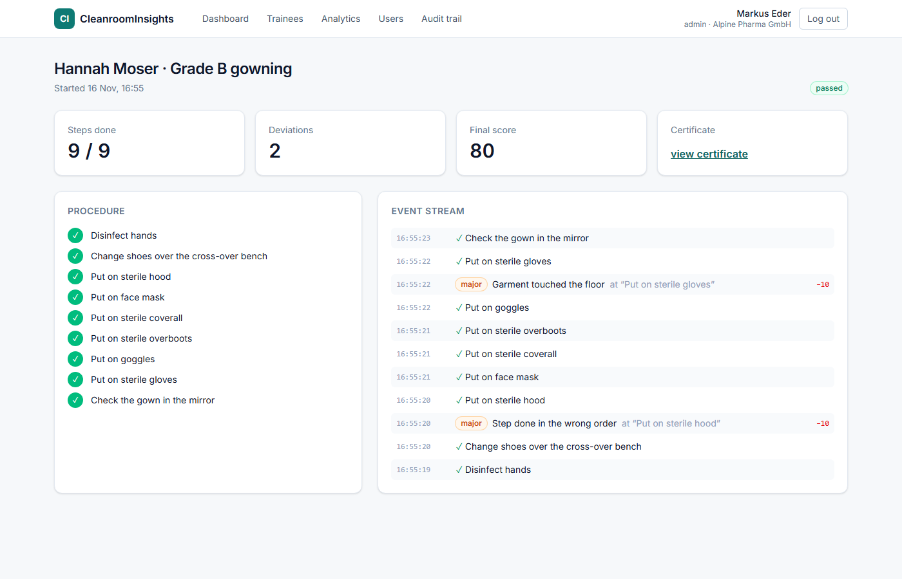
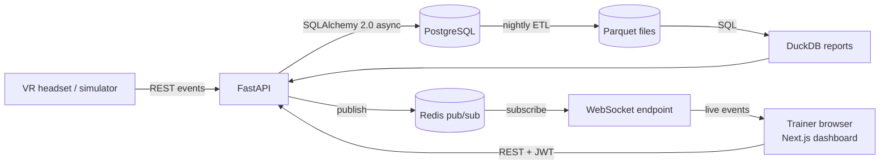

# CleanroomInsights

Analytics platform for **VR cleanroom training sessions**. A VR headset sends what a trainee does
(gowning steps, aseptic-behaviour deviations); trainers watch sessions live, see where people make
mistakes and track progress; trainees get certificates; every relevant action lands in a GMP-style
audit trail.

[](https://github.com/vladimirmilivojevic-creator/cleanroom-insights/actions/workflows/ci.yml)

**Live demo:** _see links below_ · **API docs (OpenAPI):** `<api-url>/docs`

| Demo account | Role | Sees |
| --- | --- | --- |
| `trainer@alpine.demo` | trainer | dashboard, live sessions, trainee progress, heatmaps |
| `admin@alpine.demo` | admin | everything + users, audit trail, "run ETL now" |
| `lukas@alpine.demo` | trainee | own progress and certificates only |

Password for all: `demo1234`. The login page has one-click buttons. A second organisation
(`trainer@nordic.demo`) shows that tenants never see each other's data.

> The API runs on a free plan, so the first request after a quiet period can take up to a minute.



## What it does

| Feature | How |
| --- | --- |
| **Event ingestion** | `POST /api/sessions/{id}/events` – the headset sends `step` or `deviation` events. Pydantic validates the payload; severity and penalty come from the server-side catalogue, never from the client. |
| **Live session view** | WebSocket `/ws/sessions/{id}`. Every stored event is published to Redis pub/sub (`session:{id}` channel) and pushed to all trainers watching. Without Redis an in-process broadcaster is used. |
| **Simulated headset** | "Start simulated session" on the dashboard, or `backend/scripts/simulate_headset.py` which drives the public API over HTTP. |
| **Scoring** | `100 − penalties` (minor 3, major 10, critical 25). Pass = score ≥ 80 **and** no critical deviation. A step never done becomes a critical `skipped_step`. |
| **Certificates** | Issued on pass, valid 12 months (annual requalification), public verification page by code, printable. |
| **Multi-tenancy** | Every table has `organization_id`; every query filters by the tenant from the JWT. Other tenants' objects return **404**, not 403. |
| **Auth & RBAC** | OAuth2 password flow → JWT (HS256, 8 h). Roles `admin`, `trainer`, `trainee` enforced by FastAPI dependencies (`require_roles`). bcrypt password hashing. |
| **Audit trail** | Append-only, hash-chained per organisation (each entry includes the previous entry's SHA-256). `GET /api/audit/verify` detects any edited or deleted row. Logins, failed logins, user changes (old → new value), session start/finish, certificates. |
| **Analytics** | Overview KPIs, deviation heatmap (step × deviation type), trainee progress, score over time. |
| **Nightly ETL** | PostgreSQL → Parquet (written atomically) → reports computed by **DuckDB** directly on the Parquet files: weekly trend, pass rate per module, costliest deviations. Runs at 02:00 UTC and on demand. |

## Architecture



```
backend/
  app/
    main.py          FastAPI app, lifespan (seed demo data, start nightly ETL)
    config.py        settings from environment variables (pydantic-settings)
    db.py            async engine, session dependency, UTC timestamps
    models.py        SQLAlchemy 2.0 models (typed Mapped[] columns)
    schemas.py       Pydantic v2 request/response models
    domain.py        training modules, deviation catalogue, scoring rules
    services.py      session logic shared by API and simulator
    security.py      bcrypt + JWT
    deps.py          current user, role checks (RBAC)
    audit.py         hash-chained audit trail
    live.py          Redis / in-memory pub-sub
    etl.py           PostgreSQL -> Parquet -> DuckDB
    routers/         auth, users, sessions, live (WebSocket), analytics, certificates, audit
  alembic/           database migrations
  tests/             pytest (API, WebSocket, RBAC, tenancy, audit tampering, ETL)
frontend/
  src/app/           Next.js App Router pages
  src/lib/           API client, auth context, TanStack Query hooks, types
  src/components/    UI, heatmap, charts
  e2e/               Playwright tests
```

## Run it locally

**Option 1 – everything in Docker** (PostgreSQL, Redis, API, dashboard):

```bash
docker compose up --build
# dashboard http://localhost:3000 · API docs http://localhost:8000/docs
```

**Option 2 – without Docker** (SQLite and in-process pub/sub, no services needed):

```bash
cd backend
python -m venv .venv && source .venv/bin/activate   # Windows: .venv\Scripts\activate
pip install -r requirements-dev.txt
uvicorn app.main:app --reload                        # http://localhost:8000/docs

cd ../frontend
npm install
npm run dev                                          # http://localhost:3000
```

Play a session from the "headset" while the dashboard is open:

```bash
python scripts/simulate_headset.py --email lukas@alpine.demo --module gowning --skill 0.5
```

## Tests

```bash
cd backend && pytest                    # 58 tests, coverage report, fails under 85 % (currently ~97 %)
cd frontend && npx playwright test      # starts API + dashboard, 8 browser tests
```

Backend tests cover authentication, RBAC per role, tenant isolation (REST and WebSocket), event
validation, scoring and certificates, the live WebSocket stream, audit-chain tampering detection,
the ETL and DuckDB reports, and both pub/sub implementations (Redis via `fakeredis`).
Locally they run on SQLite; **CI runs the same suite on PostgreSQL**.

## CI/CD

GitHub Actions (`.github/workflows/ci.yml`) on every push and pull request:

1. **Backend** – ruff, `alembic upgrade head` + `alembic check` (migrations match the models), pytest with coverage gate on a PostgreSQL service container.
2. **Frontend** – ESLint, TypeScript, Prettier, production build.
3. **E2E** – Playwright against the real API and dashboard.
4. **Docker** – both images build.

Deployment: the dashboard is on **Vercel**, the API on **Render** (Docker, `render.yaml`) with
**Neon** PostgreSQL and Render Key Value (Redis). Both redeploy automatically from `main`.

## Design decisions

- **Explicit queries, no lazy loading.** Async SQLAlchemy cannot lazy-load; relationships that are always needed use `lazy="joined"`, everything else is an explicit `select`.
- **Server owns the rules.** The headset only reports what happened; severity, penalty, score and pass/fail are computed on the server from one catalogue (`domain.py`).
- **404 for other tenants.** Returning 403 would confirm that an ID exists in another organisation.
- **WebSocket gap-free.** The server sends `subscribed` once the pub/sub subscription is active; only then does the client load the snapshot over REST, and it de-duplicates by event ID.
- **Analytics off the operational DB.** Heavy reports run in DuckDB on Parquet files, not on the PostgreSQL that serves the app. The same files could live on S3 and be registered in a DuckLake catalog.

## Next steps for production

- Refresh tokens in httpOnly cookies and a short-lived ticket for the WebSocket instead of a token in the query string
- Device credentials for headsets (per-device API keys) instead of user tokens
- Rate limiting on login, Postgres advisory lock around audit writes, row-level security as a second tenancy guard
- ETL as a scheduled job (e.g. ECS task / Kubernetes CronJob) writing Parquet to S3, catalogued with DuckLake
- OpenTelemetry tracing, Prometheus metrics, structured logs
- SCORM / xAPI export so results flow into a customer's LMS

## License

MIT © Vladimir Milivojevic
